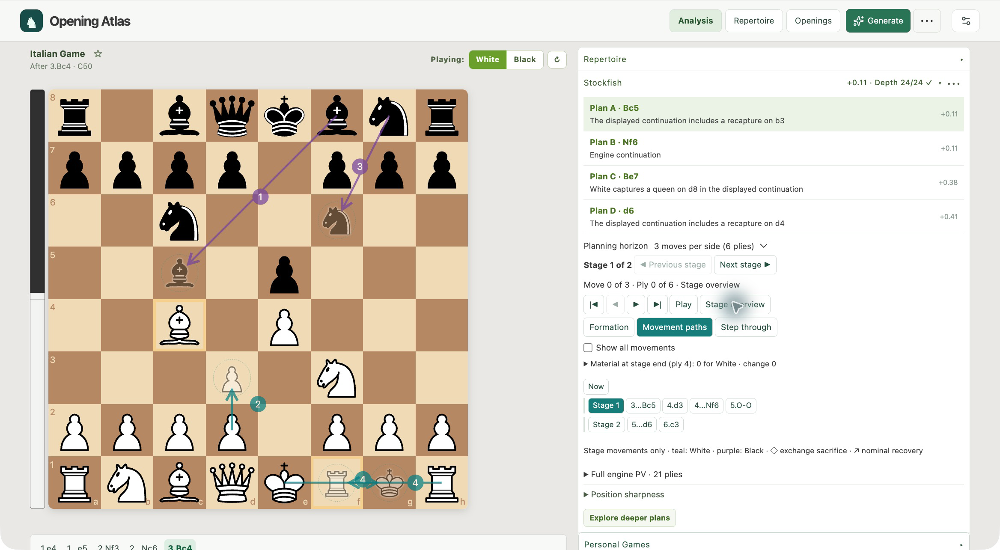
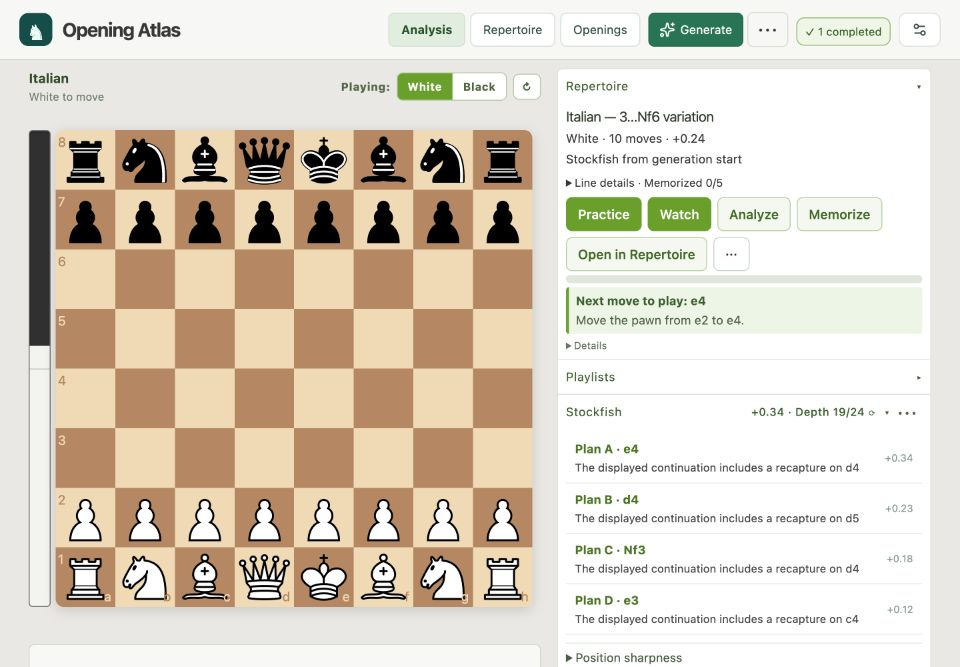

# Opening Atlas

A local chess opening trainer that combines Stockfish analysis with Lichess opening data to explore likely continuations. Generate and practice a repertoire, inspect alternative lines, and visualize an engine's future moves on the board.



Movement paths keep arrows and move-order numbers without redundant destination-square fills. Selected-move highlights remain available.



## Features

- Analyze positions with Stockfish and display candidate moves and future movement paths.
- Generate continuations using engine recommendations and, when available, Lichess opening-game frequencies; explore branches and positions shared by different move orders.
- Practice, watch, and memorize saved lines; import and export PGN.
- Store saved variations and practice progress in the browser's IndexedDB.

## Run locally

Requires Node.js 22 or later and npm. From the repository directory:

```sh
npm ci
cp node_modules/stockfish/bin/stockfish-19-lite-single.{js,wasm} public/engine/
npm run dev
```

Open the local URL printed by Vite. The `cp` command uses shell brace expansion (supported by macOS and Linux shells); on other systems, copy the two named files separately. The app runs locally; background generation needs the Vite server and does not work with static files alone.

## Testing

```sh
npm test
npm run build
```

The release candidate was checked with Node 22: 598 tests passed, one was skipped, and the production build succeeded. The build emits a bundle-size advisory. Tests include mocked external services and do not establish that live Lichess access works.

## Architecture

React and TypeScript manage the board and practice interface. chess.js handles legal positions and move validation. A browser worker runs Stockfish; searches are queued, cancellable, and cached. The opening tree connects shared positions while retaining each line's move order. A local Node/Stockfish process handles background generation. Lichess Explorer supplies historical move frequencies when access is available; the published-opening fallback is labeled and has no frequency data.

## Privacy and limitations

- Lichess Explorer requires a connected account in the tested environment. Without access it can return HTTP 401; the fallback shows published lines without invented statistics.
- Lichess access tokens are stored in browser local storage where available, with session storage as a fallback. Scripts running on the same origin can access them; use a trusted local browser profile, do not expose the server to untrusted networks, and disconnect when finished. Saved lines remain in browser storage and can be lost when the profile is cleared.
- Optional Maia-2 and Patricia integrations require separate installation. Basic engine analysis does not require either. Analysis may stop at a time or move limit; engine evaluations and historical frequencies are not guarantees of a game's outcome.
- The documented setup is for local use. Static deployment, public multi-user operation, and cross-device storage have not been verified.

## License and credits

The original app code is licensed under GPL-3.0-or-later; see [LICENSE](LICENSE). Stockfish.js, chess.js, the Lichess opening catalog, and other components have separate licenses and notices; see [THIRD_PARTY_NOTICES.md](THIRD_PARTY_NOTICES.md). Stockfish's npm package is GPL-3.0: if redistributing built engine files, provide corresponding source and preserve applicable notices.
